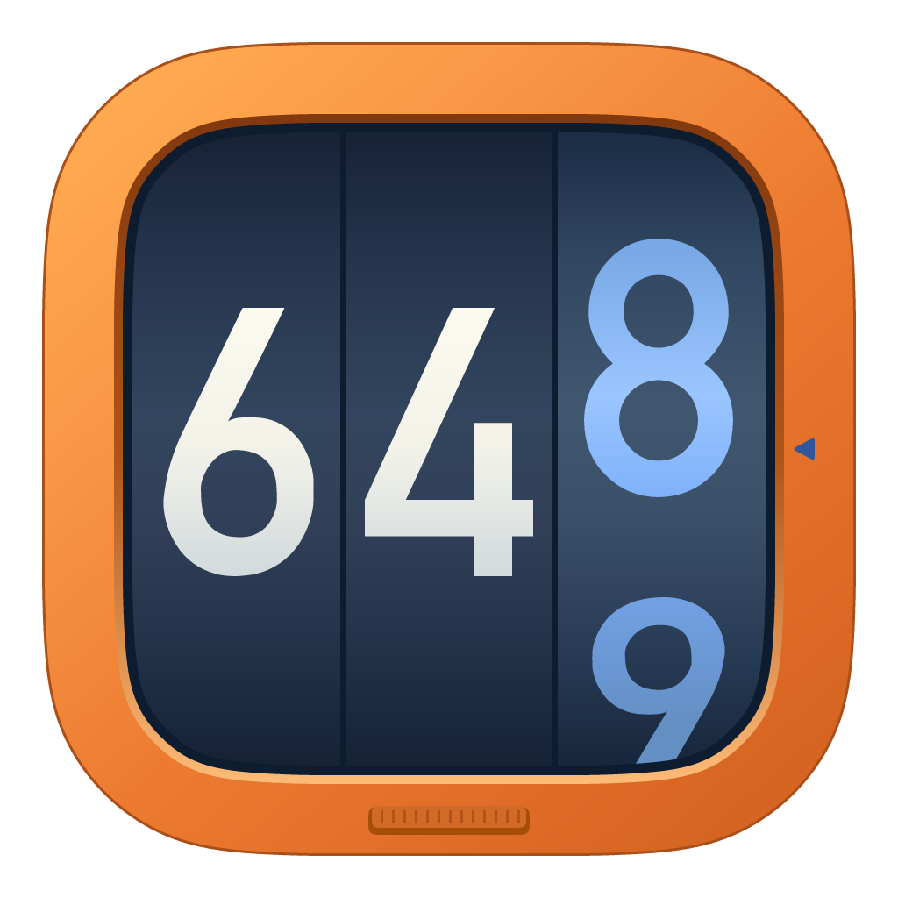

<p align="center">
  
</p>

<h1 align="center">Tokenory</h1>

<p align="center"><strong>在 Mac 上，看清你的 AI 编程用量。</strong></p>

<p align="center">
  原生 macOS 菜单栏应用，汇总多个 AI 编程工具的 Token 用量、费用估算与历史趋势。<br>
  账本保存在本机，无需注册 Tokenory 账号或部署服务。
</p>

<p align="center">
  macOS 15+ · Apple Silicon · 简体中文 / English · MIT License
</p>

<p align="center">
  <a href="https://tokenory.ryek.ee">正式官网</a> ·
  <a href="https://github.com/ryekee/tokenory/releases/latest"><strong>下载最新版本</strong></a> ·
  <a href="#功能">功能介绍</a> ·
  <a href="#支持的客户端">支持的客户端</a> ·
  <a href="#使用指南">使用指南</a>
</p>

## 功能

### 今日用量，随手查看

点击菜单栏图标，即可查看今天的 Token 用量、费用估算和各工具用量。采集状态与手动刷新入口也在这里，无需打开完整窗口。

### 趋势与明细，集中掌握

在统计窗口按日期、工具、提供方和模型筛选用量。趋势图展示使用变化，工具分布和模型排行帮助你了解用量构成。明细页支持按 Codex 对话标题或会话 ID 搜索，查看单个对话在当前范围的用量。

### 多个工具，自动汇总

支持 42 个 AI 编程客户端的来源发现与用量采集，包括 Claude Code、Codex CLI、Cursor、Gemini CLI 和 OpenCode。自动读取可用的本地日志、数据库或已有缓存，也可为支持额外目录的客户端添加路径。

默认每轮采集结束 60 秒后再次扫描，可在设置中调整。重复扫描不会重复累加；会话累计用量按最新快照更新。

### 费用口径，清楚区分

Tokenory 按 API 参考费率估算美元费用，单独保留来源报告的成本。缺少适用费率的记录标为待计价。实际订阅费用以服务商账单为准。 OpenClaw 有原生请求时间的记录支持按北京时间计算 DeepSeek 峰谷参考价。小米 Token Plan 用量按对应 MiMo API 参考价折算，OpenRouter 的 Step 3.5 Flash 免费路由按零美元计。

价格更新会先备份，再补齐待计价记录。已有金额沿用当时的费率。按新费率重算前，可以先预览差额。

### 历史记录，留在本机

已采集的历史在源会话删除后仍会保留。支持导入 CC Switch / tokens.ci 历史 JSON，先预览并处理重叠来源，再保存；也支持撤销导入、数据库备份与恢复。

用量账本和设置保存在 `~/Library/Application Support/Tokenory`。Tokenory 不向 tokens.ci 或其他排行榜上传用量，也不把提示词正文写入账本。参考价格刷新和应用更新检查需要联网。

### 融入 macOS 的日常使用

原生 SwiftUI 界面，支持简体中文和 English，可设置登录时启动。关闭窗口后继续采集，退出应用后停止采集。

内置更新检查、下载与安装，安装前由你确认。自动检查默认每天一次，可调整频率或关闭。

## 安装

1. 从 [GitHub Releases](https://github.com/ryekee/tokenory/releases/latest) 下载最新 ZIP。
2. 解压后，将 `Tokenory.app` 拖入「应用程序」。
3. 打开 Tokenory，从菜单栏查看用量或进入统计窗口。

下载版适用于 **macOS 15 或更高版本的 Apple Silicon Mac**，使用 Shenzhen Hiko Technology Co., Ltd. 的 Developer ID 签名，并附有 Apple 公证票据。

后续可通过「Tokenory → 检查更新…」或「设置 → 关于」更新（正式版 0.1.13 在「设置 → 通用」）。v0.1.2 及更早版本需先手动升级一次。

## 支持的客户端

覆盖下列 42 个工具。发现可读的用量记录后自动采集；具体接入方式见表后说明。

| | | | |
| --- | --- | --- | --- |
| Amp | Antigravity | Antigravity CLI | Claude Code |
| Cline | CodeBuddy | Codebuff | Codex CLI |
| Command Code | Copilot | Crush | Cursor |
| Devin CLI | Devin Desktop | Droid | Fx |
| Gemini CLI | Goose | Grok Build | Hermes Agent |
| Jcode | Junie | Kilo | Kilo CLI |
| Kimi | Kiro | MiMo Code | Mux |
| OpenClaw | OpenCode | OpenCodeReview | Orca |
| Pi | Qwen | Reasonix | Roo Code |
| Paseo | Trae | Warp | WorkBuddy |
| ZCode | Zed Agent | | |

- **本地日志 / SQLite**：直接复用上游解析器。开发版的「设置 → 来源」显示发现的文件、记录和读取问题。设置中可为支持额外目录的客户端添加路径。
- **Cursor、Trae、Warp**：先用上游 `tokens` CLI 同步本机缓存。Antigravity 优先读取本机 SQLite，旧版 IDE 会话也支持读取已有缓存。
- **Paseo**：发现其配置指定的 Claude / Codex 日志，归入底层工具。**Orca**：发现其 MiMo Code 沙箱数据库，归入 MiMo Code。两者不作为第二份用量累加。
- **统计精度**：保留源记录提供的粒度。只有会话总量、请求数或费用的来源不会被伪造成逐条 token 数据。新增适配器的源记录暂不参与小时分配。

<details>
<summary>如何生成本机缓存</summary>

安装上游 [`tokens` CLI](https://github.com/missuo/tokens)，按需运行对应命令。

| 工具 | 同步命令 |
| --- | --- |
| Cursor | `tokens cursor login`，再运行 `tokens cursor sync --json` |
| Trae | `tokens trae login`，再运行 `tokens trae sync` |
| Warp | `tokens warp login`，再运行 `tokens warp sync` |
| Antigravity 旧版 IDE | 客户端运行时执行 `tokens antigravity sync` |

</details>

## 使用指南

- **查看统计**：从菜单栏选「查看统计」，按日期、工具或模型筛选。
- **导入历史**：在「设置 → 数据 → 导入」（正式版 0.1.13 在统计窗口的「导入」页）预览 CC Switch 或 tokens.ci 的 JSON，核对日期和重叠来源后保存。
- **备份与恢复**：在「设置 → 数据」备份或恢复本地 SQLite 账本。恢复前会先备份当前账本。
- **卸载**：关闭登录时启动，退出后删除 App。账本和设置默认留在本机。

开发版可在「设置 → 通用 → 外观」选择跟随系统、浅色或深色，在「设置 → 采集」选择 30、60 或 120 秒的扫描间隔。

### 在多台 Mac 上汇总用量（开发版）

在使用同一 Apple 账号的每台 Mac 上打开「设置 → iCloud 同步」。首次开启时，Tokenory 会将这台 Mac 的全部有效历史汇总上传至该账号的 CloudKit 私有库。云端保存设备名称、按日期和小时划分的工具、提供方、模型、来源及其用量与费用。原始日志、会话明细和本机路径留在各自的 Mac。

「总览」会将本机用量与其他 Mac 最近一次上传的用量相加。日期选择器左边的「只看本机」切换整页的统计范围。「设置 → 来源」可查看其他设备的更新时间及各工具用量。菜单栏、HUD、记录和速度仍取自本机账本。 合并总览按北京时间显示有可靠时间戳的本机事件和小时分布。Mac 的系统时区可以不同。只提供日期的历史导入与仅有近似时间的记录保留原日期。

每台 Mac 重传时会替换自己的汇总。**两台 Mac 导入同一份历史，重叠用量会计入两次。** 同一份历史只需在一台 Mac 导入。模型数和活跃天数分别按不同的模型名和账本日期统计。

| 设置中的操作 | 结果 |
| --- | --- |
| 关闭 iCloud 同步 | 本机停止发起上传。已提交的上传处理完毕后，开关显示为关闭。其他设备仍可看到最后一次成功上传的汇总。 |
| 删除本机云端数据 | 本机停止上传，并从云端合计中移除这台 Mac 的全部用量。其他 Mac 继续同步。 |
| 删除全部云端数据 | 清空此 Apple 账号下所有 Mac 的云端用量，各台 Mac 的上传授权一并失效。 |

三个操作都保留各台 Mac 的本地账本。删除需联网完成。此后在哪台 Mac 手动重新开启同步，就会重新上传那台 Mac 的全部历史，包括停传期间新采集的用量。 删除结果未获确认时，可先核实上次删除，或重新确认一次新删除。

## 开发

<details>
<summary>从源码构建与运行</summary>

需要 macOS 15+、Xcode、[XcodeGen](https://github.com/yonaskolb/XcodeGen) 和 `rust-toolchain.toml` 指定的 Rust。当前验证平台是 Apple Silicon。项目内 `.tools/cargo` / `.tools/rustup` 也受支持。

```sh
git clone https://github.com/ryekee/tokenory.git
cd tokenory
./script/build_and_run.sh
```

只构建：

```sh
./script/build.sh
# Release 构建
TOKENORY_CONFIGURATION=Release ./script/build.sh
```

Debug 产物为 `.build/xcode/Build/Products/Debug/Tokenory.app`，Release 产物在同级 `Release` 目录。这两种本机构建使用 ad-hoc 签名。要在真机验证 iCloud 同步，使用有 Hiko 团队开发签名与 iCloud 容器权限的 Xcode 账号运行 `TOKENORY_CONFIGURATION=CloudDebug ./script/build.sh`，产物位于同级 `CloudDebug` 目录，使用 CloudKit Development 环境。App 已包含 Rust helper，登录启动可在设置中开启。

### 验证与维护

```sh
cargo test --manifest-path cli/Cargo.toml
cargo clippy --manifest-path cli/Cargo.toml --all-targets -- -D warnings
./script/build.sh
xcodebuild -project macos/Tokenory.xcodeproj -scheme Tokenory \
  -derivedDataPath .build/xcode -destination 'platform=macOS' test
```

测试使用独立数据目录，不写个人用量。`macos/project.yml` 是工程源文件，`.xcodeproj` 由 XcodeGen 生成。

- [官网构建与预览](site/README.md)

</details>

## 开源与致谢

Tokenory 基于 [missuo/tokens](https://github.com/missuo/tokens) 的日志发现与解析能力，提供独立的原生 macOS 应用和本地用量账本。感谢上游项目及其贡献者。

<details>
<summary>架构与上游关系</summary>

| | missuo/tokens | Tokenory |
| --- | --- | --- |
| 主要入口 | CLI + Web 排行榜 | 原生 macOS App |
| 用量存储 | 上游提交与服务端流程 | 本机 SQLite 账本 |
| 展示 | Web 页面与排行榜 | 菜单栏、趋势、筛选与明细 |
| 账号与部署 | 依上游服务流程 | 无 Tokenory 账号，无需自建服务 |
| 公共排名 | 上游功能 | App 不提交用量 |
| 共享能力 | 客户端发现、解析、去重、参考价格 | 复用并按需修复 |

基于上游版本 `c2f3857c328478e2599a3ba871151ec255e00831`。`macos/` 是 SwiftUI App，`cli/tokenory/` 提供本地采集、账本和进程协议，`cli/tokens-core/` 保留并按需更新上游解析核心，`site/` 提供双语官网。上游 CLI、Web 和自托管部署入口见 [missuo/tokens](https://github.com/missuo/tokens)。

保留上游版权，遵循 [MIT License](LICENSE)。图标归属见 [品牌资源说明](assets/brand/NOTICE.md)。

</details>
