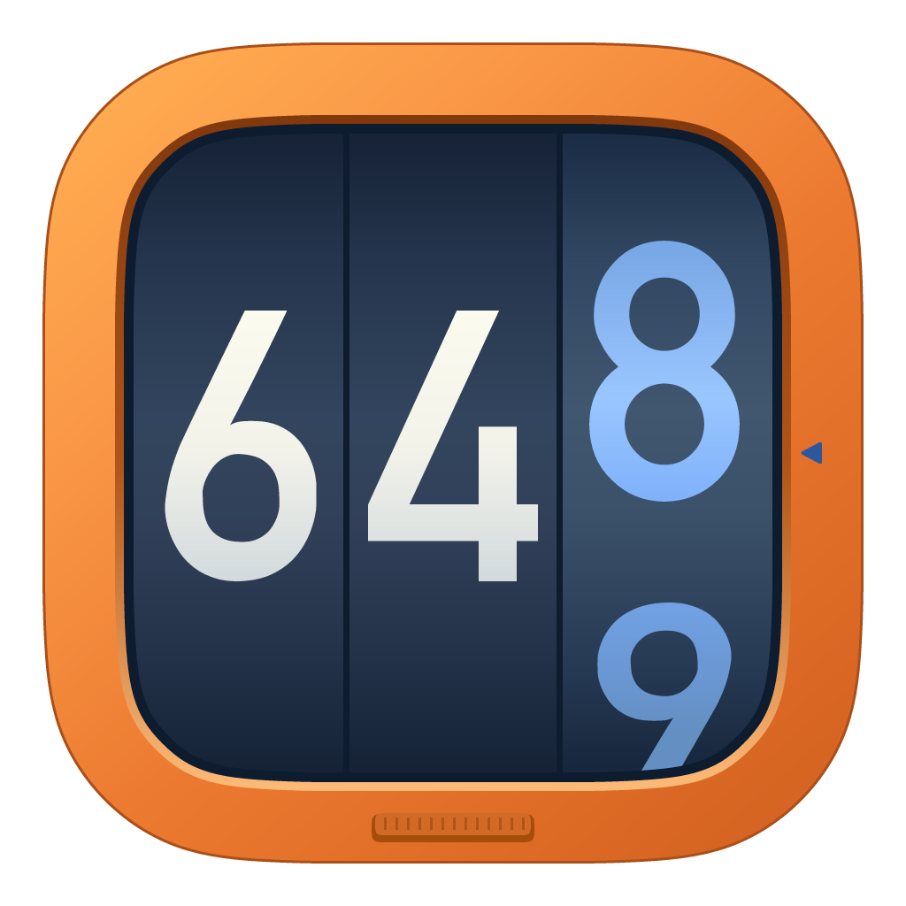

<p align="center">
  
</p>

<h1 align="center">Tokenory</h1>

<p align="center"><strong>在 Mac 上，看清你的 AI 编程用量。</strong></p>

<p align="center">
  原生 macOS 菜单栏应用，汇总多个 AI 编程工具的 Token 用量、费用估算与历史趋势。<br>
  数据保存在本机，无需注册账号，无需部署服务。
</p>

<p align="center">
  macOS 15+ · Apple Silicon · 简体中文 / English · MIT License
</p>

<p align="center">
  <a href="https://github.com/ryekee/tokenory/releases/latest"><strong>下载最新版本</strong></a> ·
  <a href="#功能">功能介绍</a> ·
  <a href="#支持的客户端">支持的客户端</a> ·
  <a href="docs/local/operations.md">使用指南</a>
</p>

## 功能

### 今日用量，随手查看

点击菜单栏图标，即可查看今天的 Token 用量、费用估算和各工具用量。采集状态与手动刷新入口也在这里，无需打开完整窗口。

### 趋势与明细，集中掌握

在统计窗口按日期、工具、提供方和模型筛选用量。趋势图展示使用变化，工具分布和模型排行帮助你了解用量构成；需要追溯时，可以继续查看记录明细。

### 多个工具，自动汇总

支持 42 个 AI 编程客户端的来源发现与用量采集，包括 Claude Code、Codex CLI、Cursor、Gemini CLI 和 OpenCode。自动读取可用的本地日志、数据库或已有缓存，也可为支持额外目录的客户端添加路径。

默认每轮采集结束 60 秒后再次扫描，可在设置中调整。重复扫描不会重复累加；会话累计用量按最新快照更新。

### 费用口径，清楚区分

区分来源提供的成本、按 API 参考价格计算的估算，以及尚未计价的用量。参考估算用于了解使用规模，不代表实际订阅账单。

价格更新自动补齐待计价记录，并在回填前备份；已有金额不会自动改写。需要按新价格重算时，可先预览变化，再决定是否应用。详细规则见 [估算口径](docs/local/pricing.md)。

### 历史记录，留在本机

已采集的历史在源会话删除后仍会保留。支持导入 CC Switch / tokens.ci 历史 JSON，先预览并处理重叠来源，再保存；也支持撤销导入、数据库备份与恢复。

用量账本和设置保存在 `~/Library/Application Support/Tokenory`。Tokenory 不向 tokens.ci 或其他排行榜上传用量，也不把提示词正文写入账本。参考价格刷新和应用更新检查需要联网。

### 融入 macOS 的日常使用

原生 SwiftUI 界面，支持简体中文和 English，可设置登录时启动。关闭窗口后继续采集，退出应用后停止采集。

内置更新检查、下载与安装，安装前由你确认。自动检查默认每天一次，可调整频率或关闭。

## 安装

1. 从 [GitHub Releases](https://github.com/ryekee/tokenory/releases/latest) 下载最新 ZIP。
2. 解压后，将 `Tokenory.app` 拖入「应用程序」。
3. 打开 Tokenory，从菜单栏查看用量或进入统计窗口。

下载版适用于 **macOS 15 或更高版本的 Apple Silicon Mac**，使用 Shenzhen Hiko Technology Co., Ltd. 的 Developer ID 签名，并附有 Apple 公证票据。

后续可通过「Tokenory → 检查更新…」或「设置 → 通用」更新。v0.1.2 及更早版本需先手动升级一次。

## 支持的客户端

覆盖下列 42 个工具。发现可读的用量记录后自动采集；具体接入方式见表后说明。

| | | | |
| --- | --- | --- | --- |
| Amp | Antigravity | Antigravity CLI | Claude Code |
| Cline | CodeBuddy | Codebuff | Codex CLI |
| Command Code | Copilot | Crush | Cursor |
| Devin CLI | Devin Desktop | Droid | Fx |
| Gemini CLI | Goose | Grok Build | Hermes Agent |
| Jcode | Junie | Kilo | Kilo CLI |
| Kimi | Kiro | MiMo Code | Mux |
| OpenClaw | OpenCode | OpenCodeReview | Orca |
| Pi | Qwen | Reasonix | Roo Code |
| Paseo | Trae | Warp | WorkBuddy |
| ZCode | Zed Agent | | |

- **本地日志 / SQLite**：直接复用上游解析器。来源页显示发现的文件、记录和读取问题。设置中可为支持额外目录的客户端添加路径。
- **Cursor、Trae、Warp、Antigravity IDE**：读取已有的上游格式缓存。Tokenory App 不包含它们的账号登录与缓存同步界面，也不会自动请求这些账号接口。
- **Paseo**：发现其配置指定的 Claude / Codex 日志，归入底层工具。**Orca**：发现其 MiMo Code 沙箱数据库，归入 MiMo Code。两者不作为第二份用量累加。
- **统计精度**：保留源记录提供的粒度。只有会话总量、请求数或费用的来源不会被伪造成逐条 token 数据。新增适配器的源记录暂不参与小时分配。

接入范围、路径、缓存生成方式和验证边界见 [来源说明](docs/local/sources.md)。仅安装客户端不保证存在可读的用量记录；支持解析格式不代表已在 42 个真实客户端上逐一验收。

## 文档

- [使用、备份、恢复及卸载](docs/local/operations.md)
- [客户端支持与本地格式](docs/local/sources.md)
- [估算口径](docs/local/pricing.md)
- [macOS 发布说明](docs/local/releases.md)

## 开发

<details>
<summary>从源码构建与运行</summary>

需要 macOS 15+、Xcode、[XcodeGen](https://github.com/yonaskolb/XcodeGen) 和 `rust-toolchain.toml` 指定的 Rust。当前验证平台是 Apple Silicon。项目内 `.tools/cargo` / `.tools/rustup` 也受支持。

```sh
git clone https://github.com/ryekee/tokenory.git
cd tokenory
./script/build_and_run.sh
```

只构建：

```sh
./script/build.sh
# Release 构建
TOKENORY_CONFIGURATION=Release ./script/build.sh
```

Debug 产物为 `.build/xcode/Build/Products/Debug/Tokenory.app`，Release 产物在同级 `Release` 目录。本机构建使用 ad-hoc 签名。App 已包含 Rust helper，登录启动可在设置中开启。

### 验证与维护

```sh
cargo test --manifest-path cli/Cargo.toml
cargo clippy --manifest-path cli/Cargo.toml --all-targets -- -D warnings
./script/build.sh
xcodebuild -project macos/Tokenory.xcodeproj -scheme Tokenory \
  -derivedDataPath .build/xcode -destination 'platform=macOS' test
```

测试使用独立数据目录，不写个人用量。`macos/project.yml` 是工程源文件，`.xcodeproj` 由 XcodeGen 生成。

- [客户端兼容性验证](docs/local/client-compatibility.md)
- [实施状态与验收边界](docs/local/acceptance.md)
- [历史迁移对账](docs/local/migration.md)

</details>

## 开源与致谢

Tokenory 基于 [missuo/tokens](https://github.com/missuo/tokens) 的日志发现与解析能力，提供独立的原生 macOS 应用和本地用量账本。感谢上游项目及其贡献者。

<details>
<summary>架构与上游关系</summary>

| | missuo/tokens | Tokenory |
| --- | --- | --- |
| 主要入口 | CLI + Web 排行榜 | 原生 macOS App |
| 用量存储 | 上游提交与服务端流程 | 本机 SQLite 账本 |
| 展示 | Web 页面与排行榜 | 菜单栏、趋势、筛选与明细 |
| 账号与部署 | 依上游服务流程 | 无 Tokenory 账号，无需自建服务 |
| 公共排名 | 上游功能 | App 不提交用量 |
| 共享能力 | 客户端发现、解析、去重、参考价格 | 复用并按需修复 |

基于固定上游版本 `c2f3857c328478e2599a3ba871151ec255e00831`。`macos/` 是 SwiftUI App，`cli/tokenory/` 是本地采集、账本和进程协议，`cli/tokens-core/` 保留上游解析核心。原 `cli/tokens-cli/`、`web/` 和 npm 包保留以便追溯和按需使用，**不是 Tokenory App 的运行依赖**。它们保留原本的联网、登录和提交命令，不能与本地 helper `tokenory` 混淆。

上游来源、构建约定和同步原则见 [上游说明](docs/local/upstream.md)。保留上游版权，遵循 [MIT License](LICENSE)。图标归属见 [品牌资源说明](assets/brand/NOTICE.md)。

</details>
