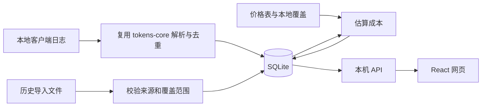

# Tokens Local：自用 token 与估算成本追踪方案

日期：2026-11-02。状态：研究方案，尚未创建 GitHub fork、修改产品代码、安装依赖或运行构建。等用户打开项目目录后再实施。

## 1. 已确认的目标

- 本机后台采集，在浏览器查看；首个运行目标是这台 Mac。
- cost 按模型 API 单价估算，不追踪实际订阅支出或账单。
- 从 `missuo/tokens` fork，保留有价值的解析器和图表代码。
- 已恢复的历史用量应直接出现在总数、每日图表和模型明细中。
- 采集过的数据不能因为源客户端清理日志而消失。

建议暂称 **Tokens Local**，命令暂称 `tokens-local`。名称和下面的 CLI 拼写均为方案，不是现有功能。

首版最重要的验收结果：**8,694,071,481 历史 tokens 能完整计入；重复导入和扫描不增加重复用量；新使用能持续入库；总数与图表明细一致；未知价格不显示为免费。**

## 2. 研究基线与可复用能力

本次检查的仓库：`missuo/tokens`，`main` commit `c2f3857c328478e2599a3ba871151ec255e00831`。本机安装的 CLI 是 `27.1.5`。实施开始时应重新核对上游状态，再锁定基线。

| 模块 | 当前实际能力 | 自用版处理 |
| --- | --- | --- |
| `cli/tokens-core/src/sessions/`、`scanner.rs` | 多客户端日志发现、解析与规范化 | 复用，先验证 Claude Code、Codex 的完整流程 |
| `sessions/claudecode.rs` | 按 message/request 身份合并流式重复记录 | 复用原有去重逻辑，不重写解析器 |
| `sessions/codex.rs` | 累计 token 差分、fork/replay 去重、缓存与 reasoning 处理 | 复用，作为必须保留的回归行为 |
| `sessions/mod.rs` | `UnifiedMessage` 包含 tokens、时间、会话、模型、`dedup_key`、cost 来源和部分计价元数据 | 用作本地持久化的输入边界 |
| `pricing/` | LiteLLM、OpenRouter、models.dev、自定义价格、模型别名与缓存 | 复用价格查找和计算；增加明确的估算完整性及价格快照 |
| `message_cache.rs` | 提高重复扫描效率，包含部分历史保留逻辑 | 继续作为可重建缓存；独立数据库承担长期保存 |
| `commands/import.rs` | 第三方格式转换 | 复用解析结果；新 import 必须真正入库 |
| `web/src/components/profile/` | 趋势图、热力图、模型统计等 React 组件 | 按实际页面需要移植，保留图表已有测试 |
| `web/src/lib/db/`、认证、排行榜 | PostgreSQL、用户/设备/提交表、GitHub 登录、公共排名 | 不作为本机版运行路径 |

两点代码层面的限制：

1. `parse_local_clients()` 输出的 `ParsedMessage` 不保留完整的 `dedup_key` 等字段。本地采集应优先使用 `parse_local_unified_messages()` 或对它做小范围接口适配，不能从报表 JSON 倒推请求身份。
2. `UnifiedMessage` 是解析结果，不是长期数据库。上游缓存、价格服务和当前扫描结果不能直接充当长期数据存储。

当前网页方案使用 Next.js、PostgreSQL，仓库已有 Docker 自部署配置；它可以自部署，但仍包含公共服务所需的账户、排名和部署流程。

## 3. 推荐架构

**Rust 采集与本机服务 + SQLite + React 静态网页。**



建议新增：

- `cli/tokens-local/`：本地持久化、扫描调度、导入、本机 HTTP API。复用已有 Tokio 和 rusqlite；HTTP 层采用 Axum。
- `web-local/`：React + TypeScript + Vite，复用现有图表、格式化和基础组件。
- `docs/local/`：数据口径、迁移步骤、上游同步说明。

保留上游 `tokens-core` 目录结构。只在有明确需求时修改共享核心，避免把本机存储耦合进各个解析器。现有公共网页代码可留在 fork 中，首版不要求它与本地版共享运行时或数据库。

日常运行是一份服务程序加一份构建后的网页资源；Node/Bun 只在构建时使用。先采用普通资源目录交付，无需先做安装器、单文件嵌入或自动更新。

| 方案 | 优点 | 代价 | 判断 |
| --- | --- | --- | --- |
| 直接部署原 Next.js + PostgreSQL | 最接近原站，上游改动少 | 本机还要维护数据库服务、认证和公共站点配置 | 不符合这次追求的轻量自用方式 |
| 在原 Next.js 中全面替换存储与认证 | 页面复用较多 | 会深入修改大量服务端查询和假设，后续同步容易冲突 | 不优先 |
| **保留 Rust 核心，新增本机服务和静态网页** | 一份本地数据库；采集、导入、查询边界清楚 | 要增加持久化/API，并移植所需 UI | **推荐** |
| 重新实现全部日志解析 | 可以完全自主设计 | 重复处理流式重复、累计计数、fork、模型定价等已有细节 | 没有必要 |

只绑定 loopback 地址，网页与写入 API 同源。本机版采用独立数据目录和配置目录；不读取 tokens.ci 的登录令牌，也不自动向它上传。价格更新只下载公开价格数据。

## 4. 数据如何长期保存

### 原始日志采集

- 使用上游规范化后的 token 分类和请求去重键。
- 同一事件重复扫描执行 upsert，更新已解析的最终结果，不再次累加一份。
- 源文件删除或暂时不可读时，保留已入库统计；扫描失败不变成“这段用量是零”。
- 不把“总是取最大值”当作全局规则：它会阻止正确的下调修正。流式合并由对应解析器负责，数据库持久化它的结果。
- 记录 parser 版本和来源，解析器升级后只重算仍有原始记录的部分；不能把已无原始日志的历史标成已经重新验证。
- 第一项实施检查是实测 Claude/Codex 的稳定键覆盖率。若遇到没有稳定键的真实记录，再给该解析器补身份或来源信息；不提前建立通用事件推断系统，也不生成随机 ID 冒充请求身份。

数据库只保存必要用量元数据，不保存提示词和回答正文。会话、项目、模型等维度只在来源确实提供时保存。

### 历史汇总导入

历史记录保留其真实精度：只有“日期 + 客户端 + 模型”的记录就以日汇总存储。不能生成假会话、假请求时间，也不能把累计总数平均分配到每日。

导入流程：**选择文件或已知本地数据库 → 展示日期范围、tokens、cost 完整性与重叠情况 → 写入事务 → 总数和图表立即更新。**

重复导入同一来源和同一内容不增加数量；同一来源更新后的导出按稳定的日/客户端/模型键替换对应范围，不简单 append。保留导入批次和原始统计快照，便于撤销整批导入。

### 来源重叠

“更详细”不等于“更完整”。现存日志可能只剩某天的一部分，不能自动用它覆盖整天历史汇总。

首版采用可检查的覆盖规则：

- 同一日期、同一客户端，明确选择一份有效来源；该来源内再按模型汇总。
- 不相交的日期或不同客户端可以相加。
- 跨来源重叠时展示差异，由导入预览确定采用哪份；不取最大值、不相加、不自动猜测差额。
- 不同日期时区、半天快照等无法直接比较的范围进入待核对状态，保存来源但不静默计入。
- 所有报表查询同一个“有效用量”视图；历史/采集只是来源属性，不能再次出现“导入成功却不进总数”的分叉。

逻辑上需要保存：规范化事件、导入日汇总、导入批次及覆盖选择、价格快照。首版直接查询 SQLite 聚合；只有实测出现查询瓶颈后才增加汇总缓存。

## 5. Tokens 和 cost 的统一口径

### Tokens

保留 `tokens-core` 的互不重叠分类：新输入、缓存读取、缓存写入、普通输出、reasoning。总数为这些分类之和。

Codex 的原始 `input_tokens` 包含缓存读取，`reasoning_output_tokens` 又是输出的子集；上游已经进行拆分。不能对原始字段机械相加。UI 可以把普通输出和 reasoning 合并为“输出”，在明细中展开，但不要再次增加总数。

新采集记录按 `Asia/Shanghai` 分日，保留 UTC 时间戳。历史日汇总保留原始日期和能确认的时区；没有时间戳的数据不能事后准确换算日界线。当前 tokens 配置使用 `Asia/Tokyo`，迁移时必须核对来源覆盖，不能直接把所有旧日期当作上海时间重算。

### 估算成本

在费率固定、没有额外计价档位时：

`估算成本 = 新输入 × 输入单价 + 输出（含 reasoning）× 输出单价 + 缓存读取 × 读取单价 + 缓存写入 × 写入单价`

有按请求计算的上下文档位、Fast 模式或不同 cache TTL 时，沿用上游对应计价逻辑和来源元数据，不能拿每日总量触发“单次请求”的长度档位。

具体规则：

- 显示名称为 **Estimated cost / 估算成本**，币种首版统一 USD。
- 新采集用量按选定价格表计算，保存价格来源、匹配模型、快照时间和价格版本。
- 首次给历史数据估价时，明确采用的是哪个时间的价格表；不能称为已还原当时官方价格。
- 价格更新不静默改写全部旧 cost。重新估价先展示影响范围和前后变化，之后更新所选范围。
- 未知模型、缺少实际使用分类的费率或有歧义的模糊匹配：保留 tokens，cost 标为待定。明确给出的免费费率才是 0。
- 部分无法计价时，显示已知估算和待计价用量。不要把未知成本混成免费使用。
- 原始来源已带 cost 时保留它及其来源，不冒充本工具重新计算的价格。订阅使用在本工具中仍是 API 等价估算，不是实际支出。

本次恢复记录提供了一个真实验收样本：165 条模型日汇总中，**8 条有用量但 cost 为 0，涉及 772,725,441 tokens**，模型包括 `claude-opus-4-8`、`claude-sonnet-5`、`mimo-v2-pro`。这些零值需要核价，不能直接认定免费。现有来源成本合计 6,422.818221312 USD 也不能当作已经完整验证的总费用。

只有日汇总的旧数据缺少每次请求的上下文长度、速度档位和缓存 TTL 时，无法精确重算这些差异。应保留来源估算，或在有明确假设时提供基础费率估算，并标明计算依据。

## 6. 现有数据的迁移方案

这次已经有三类实际来源：

| 来源 | 数量/范围 | 用法 |
| --- | --- | --- |
| CC Switch 已恢复汇总 | 2026-04-08—2026-07-27；96 天；8,694,071,481 tokens | 首个导入验收集，完整计入 |
| tokens.ci 个人报表快照 | 本次抓取为 9,249,414,032 tokens；211 天；包含 Codex、Claude、MiCode、Copilot 等 | 保留已有历史的迁移候选；与本地采集逐范围对账 |
| Claude `stats-cache.json` | 16,521,673,486 累计 tokens，与 CC Switch 有口径差异 | 仅保留作核查，不参与相加 |

本次网站快照的总数、每日之和、模型之和一致，均为 **9,249,414,032**。其中 Claude 仅有 9 月的 5 个活跃日，与恢复的 4—7 月 Claude 数据不重叠。

因此，仅把这两份快照按现有日期/客户端口径合并时，参考合计是 **17,943,485,513 tokens（约 179.43 亿）**。这只是本次快照的迁移对账值，不是未来固定总数；网站仍在更新，也不应把这个合计再与全部本地扫描结果相加。

实施顺序：

1. 首先导入 86.94 亿历史汇总，验证分类、模型、日期和总数。
2. 导入现有网站快照到预览区，和本地扫描结果按客户端、日期范围比较。
3. 确认日界线和完整历史范围后，选择有效来源；今天这种未结束日期单独核对，不能用一份中途快照代表整天。
4. 把确认后的历史覆盖与新采集接起来；已有原始事件和汇总不能重复计数。

本轮只保存研究用快照。没有再次向官网提交、修改官网数据，也没有启动迁移程序。

## 7. 首版页面

**总览为主页面：**

- 顶部日期范围：今天、7 天、30 天、全部、自定义。
- 两个主要数值：Tokens、Estimated cost。
- 同一张趋势图切换 tokens/cost；支持客户端、模型筛选。
- 下方展示客户端/模型用量列表，点击进入对应明细。
- 最近同步时间靠近刷新操作；只有失败或缺价时才显示必要说明。

其余内容保持克制：

| 页面 | 主要用途 |
| --- | --- |
| 明细 | 按日期、客户端、模型、来源筛选；有事件身份时可查看会话维度 |
| 导入与来源 | 导入预览、重叠对比、采用的历史范围、批次撤销 |
| 价格与设置 | 未匹配模型、价格覆盖、重估预览、扫描目录、时区、备份 |

首版不需要社交账号、公开排行榜、徽章、分享卡或实际账单模块。历史来源和估价依据放在明细和导入页面，避免在每个数字旁堆次级标签。

## 8. 日常运行与恢复

建议的命令语义如下，实施时可调整具体拼写：

```text
tokens-local serve                    启动本机服务和定期采集
tokens-local scan                     扫描一次并写入本地数据库
tokens-local import --source ... FILE 导入并写入本地数据库
tokens-local export ...               导出统一统计
tokens-local backup ...               创建一致的数据库备份
```

网页刷新只读取数据库，不触发全盘重扫。建议先以每 60 秒检查一次作为目标，上次扫描未结束时不叠加任务；实际频率由本机数据量和耗时测量确定，不预先承诺性能。

macOS 使用 launchd 管理后台服务，登录后运行、异常退出可重启。扫描状态记录最近成功时间及失败原因。首次全量扫描和后续增量扫描分别测量，UI 在扫描期间仍能查看已保存的数据。

数据库放在独立的应用数据目录中，缓存和配置也与 `~/.config/tokens` 分开。使用 SQLite 的一致性备份方式，不在写入过程中直接复制主数据库文件当作完整备份。先实现备份/恢复命令和导入前备份；自动备份保留策略待首次运行后确定。

## 9. 实施拆分与验收

| 阶段 | 交付 | 必须通过的验证 |
| --- | --- | --- |
| 0：项目建立 | 用户项目目录中的 fork 工作区、锁定上游、独立配置路径 | 原始日志和现有 tokens 安装不受影响；确认 Rust 工具链 |
| 1：持久化与历史导入 | SQLite schema、覆盖规则、CC Switch importer | 86.94 亿完整入库；导入两次增量为 0；撤销批次可恢复前态 |
| 2：实时采集与计价 | Claude/Codex adapter、后台扫描、价格状态 | 流式重复只计一次；Codex fork/replay 不重复；源文件消失不抹除历史；未知价不变成 0 |
| 3：本机网页 | 总览、趋势图、明细、导入预览 | 同一筛选下卡片总数 = 日期之和 = 客户端/模型之和；历史与新用量都可见 |
| 4：迁移与长期运行 | 官网快照对账、备份恢复、launchd | 选定来源不重叠；当前日期边界核对；重启后数据保留；备份恢复结果一致 |

来源优先级：先保证 Claude Code 与 Codex 的完整采集流程；同时保留上游其他解析器。网站快照中 MiCode、Copilot 等已有历史可以按汇总来源迁移；新增实时接入按本机实际使用逐一验证，不宣称所有上游客户端都已通过本机版验收。

检查沿用项目已有 Rust 入口：`cargo test --manifest-path cli/Cargo.toml`、`cargo clippy --manifest-path cli/Cargo.toml --all-targets -- -D warnings`；新网页增加自己的 typecheck、构建和关键交互检查。价格和去重回归复用已有 fixtures，历史导入使用本次导出的统计数据。真实会话正文、令牌、个人数据库不进入 Git。

本机已有 Bun 和 Node；当前没有找到 `rustc`/`cargo`。Rust 工具链安装留到用户打开项目后的实施阶段。本次未运行构建、测试或性能基准，上述为代码审查和数据核对所得方案。

## 10. 维护取舍与下一次开工

推荐方案需要维护一层本地存储/API和少量图表适配。它减少了日常服务依赖，但不是“修改几行就完成”。控制维护范围的方法是保持解析器目录结构，记录所有共享核心改动，并按需同步上游解析、去重和定价修复；不自动合入公共排行榜或云部署变更。

等项目目录就绪后，先把本方案与恢复数据作为输入，建立 fork 工作区。首个可检查结果应是：**在本地数据库里成功导入 96 天历史，并能用同一查询得到总数与每日明细**。之后再做网页外观和后台常驻。

尚需通过实施验证的项目集中为三项：真实日志的去重键覆盖、导入源的日期/覆盖对齐、真实数据量下的扫描与查询耗时。其余常规实现选择按本方案推进，无需重新询问已确认的“本机网页”和“API 单价估算”。

## 资料与本地交付

上游资料：

- [研究基线仓库](https://github.com/missuo/tokens/tree/c2f3857c328478e2599a3ba871151ec255e00831)
- [核心解析接口](https://github.com/missuo/tokens/blob/c2f3857c328478e2599a3ba871151ec255e00831/cli/tokens-core/src/lib.rs)
- [统一用量结构](https://github.com/missuo/tokens/blob/c2f3857c328478e2599a3ba871151ec255e00831/cli/tokens-core/src/sessions/mod.rs)
- [Claude 解析与去重](https://github.com/missuo/tokens/blob/c2f3857c328478e2599a3ba871151ec255e00831/cli/tokens-core/src/sessions/claudecode.rs)
- [Codex 解析与去重](https://github.com/missuo/tokens/blob/c2f3857c328478e2599a3ba871151ec255e00831/cli/tokens-core/src/sessions/codex.rs)
- [价格服务](https://github.com/missuo/tokens/blob/c2f3857c328478e2599a3ba871151ec255e00831/cli/tokens-core/src/pricing/mod.rs)
- [现有网站数据库连接](https://github.com/missuo/tokens/blob/c2f3857c328478e2599a3ba871151ec255e00831/web/src/lib/db/index.ts)
- [上游 MIT 许可证](https://github.com/missuo/tokens/blob/c2f3857c328478e2599a3ba871151ec255e00831/LICENSE)：fork 保留许可证及原版权声明。
- [Axum 文档](https://docs.rs/axum/latest/axum/)
- [Vite 静态构建](https://vite.dev/guide/build.html)
- [SQLite 备份接口](https://docs.rs/rusqlite/latest/rusqlite/backup/index.html)

同目录的现有材料：

- `cc-switch-claude-rollups-original.json`：首个历史导入输入。
- `claude-code-daily-usage.csv`：可人工核对的明细。
- `claude-stats-cache-original.json`：有口径冲突的备用证据。
- `tokens-ci-profile-2026-11-02.json`：本次网站个人数据只读快照，用于迁移对账。
- `Claude-Code-token恢复报告.md`：恢复范围及既有验证。

所有建议功能均未实现；本轮没有创建远程 fork、提交 PR、修改产品代码或启用后台服务。
