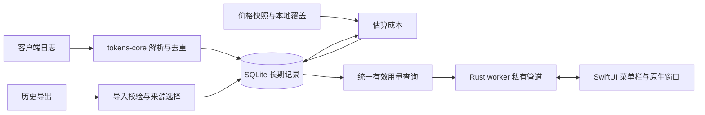

# Tokenory macOS 菜单栏应用实施计划

> **For agentic workers:** 按任务逐项执行；执行技能使用 `superpowers:executing-plans`，若用户明确选择代理协作，则使用 `superpowers:subagent-driven-development`。步骤以 `- [ ]` 跟踪。任务勾选与验收以 [实施状态](../../local/acceptance.md) 为准；未完成的现场验收不按构建结果推断。

**Goal:** 建立自用的 macOS 菜单栏应用，持续保存可取得的各工具 token 数据，按模型 API 单价估算成本，在菜单栏快速查看今日用量，并在原生窗口查询历史与新增用量。

**Architecture:** Fork `missuo/tokens`，复用 Rust 日志解析、去重和定价能力，新增 SQLite 持久化。原生 SwiftUI 应用通过 `Process` 启动 App bundle 内的 Rust worker，以标准输入/输出的 JSON Lines 通信；worker 独占采集调度及写入，菜单栏和详情窗口共用同一份查询结果。应用负责 worker 生命周期，数据库是长期记录。

**Tech Stack:** Swift / SwiftUI `MenuBarExtra` / Swift Charts / 少量 AppKit / `SMAppService.mainApp`；Rust / Tokio / rusqlite；Xcode 工程由 XcodeGen 配置生成。实现最低 macOS 15（使用原生窗口启动策略），首个验证目标是本机 macOS 27.2；依赖按锁定上游兼容性固定版本，不追逐 latest。

**Spec:** [2026-11-02 预研原文](../../research/2026-11-02-tokens-local.md)。原文作为历史依据不改写；**2026-11-05 用户将交付目标改为 macOS menubar，本计划的原生应用方案覆盖原预研中的网页、HTTP 服务和独立 launchd 部署方案。** API 估算成本、历史留存、去重及 DeepSeek 官方 API 首版范围继续有效。应用暂名 **Tokenory**，内部 CLI 为 `tokenory`。

日期：2026-11-05。状态：首版已实现、安装、迁移并完成自动化及主要现场验证；长期运行和部分 UI 验收保留待观察。详见 [实施状态](../../local/acceptance.md)。

## 1. 交付目标与范围

首个数据验收结果：**把 8,694,071,481 历史 tokens 写入独立 SQLite，查询总数、日期及模型明细一致，重复导入后增量为 0。** T1 同时验证菜单栏场景能启动和退出；统计界面在数据口径通过后接入真实数据。

首版完成后，应能完成以下操作：

1. 点击菜单栏图标查看今日 tokens 和估算成本；打开统计窗口查看 7 天、30 天、全部及自定义范围。
2. 按工具、模型查看趋势与明细；有真实会话数据时才能查看会话。
3. Claude Code / Codex 及通过其他工具调用的 DeepSeek 官方 API 新用量持续入库；收起弹窗或关闭统计窗口不影响采集，退出 Tokenory 则停止采集。DeepSeek 的实际调用工具及日志入口在 T1 确认。
4. 导入旧记录，先检查重叠，再立即计入同一套报表；可撤销导入批次。
5. 查明某个数字来自哪份数据、采用什么价格；缺价格的用量可见。
6. 客户端删除日志、程序重启或升级后，已保存用量仍在；备份可恢复。

### 菜单栏与窗口分工

| 界面 | 首版内容 | 行为 |
| --- | --- | --- |
| 菜单栏图标 | Tokenory 图标 | 默认不占 Dock；点击展开 `MenuBarExtra` 的 window 样式面板 |
| 快速面板 | 今日 tokens、估算成本、工具用量摘要；最近采集状态；立即扫描、查看统计、设置、退出 | 默认今日；缺价或失败才显示必要状态。弹窗打开只读库，不触发全盘扫描 |
| 统计窗口 | 总览趋势、明细、导入与来源 | 单实例按需打开；完整筛选和复杂导入在这里完成，不塞进菜单栏面板 |
| 设置窗口 | 价格与重估、扫描目录、时区、备份/恢复、登录时启动 | SwiftUI `Settings`；开机登录选项通过系统 Login Items 管理，默认关闭 |

采用 `LSUIElement = true` 的菜单栏常驻方式；启动时显示菜单栏图标，统计窗口按需打开。应用级状态持有 worker 与共享统计，不能挂在弹窗的 `onAppear` / `onDisappear` 生命周期上。关闭窗口继续采集；点击“退出”关闭 worker 并退出应用。重新打开后补扫仍存在的源日志；不承诺恢复退出期间已被源工具清理的数据。

### “所有 AI 工具”的实施边界

覆盖目标按**实际使用清单 + 可取得的用量数据**定义，不承诺仅扫描本机就能取得所有产品的准确用量。以下接入类别共用存储与报表，不预先建立动态插件系统。

| 接入类别 | 本轮掌握的来源 | 首版安排 | 验收条件 |
| --- | --- | --- | --- |
| 本地日志 | Claude Code、Codex | 完整实时采集 | 真实记录、去重、增量更新、留存均通过 |
| 官方 API 经工具调用 | **DeepSeek 官方 API（用户已确认）**；具体调用工具尚未明确 | **首版必需**；优先从调用工具或现有调用记录取得 response usage | 保留工具/提供方/模型；缓存与 reasoning 不重复；与工具日志只计一次 |
| 已有历史汇总 | CC Switch；tokens.ci 快照中的 Claude、Codex、MiCode、Cline、Copilot | 全部进入迁移预览，核对后选择有效来源 | 分类、日期、模型及来源合计一致；没有重复 |
| 其他本地工具 | 上游已有解析器的工具；当前使用清单待补充 | 保留上游解析器；T8 按实际需要逐项启用 | 不能用“上游有模块”替代本机验收 |
| 账户 API / 导出 | 上游 README 列举 Cursor、Trae、Warp、Antigravity 需要先同步 | 确认实际使用后做具体适配；先导出导入，确需持续同步再加连接器 | 确认接口、权限、粒度及与客户端日志的重叠 |
| 其他网页聊天 / 自建 API 调用 / 图像音视频工具 | 尚未指定 | 在工具清单中标记可取得数据与缺口 | 缺少 usage 数据不能按对话条数编造 tokens；其他计费单位另行定义 |

2026-11-05 用户补充：使用 DeepSeek，通过官方 API 提供给其他工具。DeepSeek 纳入首版必需范围；具体工具及历史记录保存方式在 T1 查明，不假定经过第三方网关。Claude Code / Codex 仍是先交付的垂直流程；T8 的 DeepSeek 接入必须在首版验收前完成。

### DeepSeek 官方 API 接入决策

- **维度：**DeepSeek 是提供方，不强行当作一个新工具。例如“Codex 调用 DeepSeek”记录为工具 Codex、提供方 DeepSeek、实际模型；按工具或提供方查看的是同一份用量，不能把两份合计再相加。无法确定工具时保留未知归属。
- **采集优先级：**先读调用工具已保存的 response usage；再检查现有调用记录或平台可取得的明细/导出。导出与历史用量接口尚未验证，不承诺仅提供 Key 就能补全历史。官方 `/user/balance` 返回余额，不能用余额变化倒推 tokens。
- **协议边界：**按实际使用的 Chat Completions、Responses 或 Anthropic 兼容协议适配，复用已有 parser；不能将一种协议的字段公式直接套到另一种。只保存 usage、模型、时间、身份和必要归属元数据。
- **Chat Completions 口径：**`prompt_tokens = prompt_cache_hit_tokens + prompt_cache_miss_tokens`；cache hit 计缓存读取，cache miss 计新输入，不能当缓存写入；`completion_tokens` 已含输出中的 reasoning，若拆分则先减去已报告的 reasoning，再分别保存，总数仍为 prompt + completion。字段缺失时保留可确认的总量与缺失状态，不伪造分类。
- **Responses 口径：**从 input/output 及其 cached/reasoning 子集拆分；只对实际返回的 usage 计数，流式多次观察同一响应不累加。中断且无最终 usage 时记录缺口，不能按文本长度补数。
- **跨源去重：**同一官方响应 ID 在客户端日志和调用记录中出现时，在已确认的提供方/账户范围内认作同一事件；不同请求即使 tokens 相同也分别计数。缺少可关联身份时不猜测合并，选择单一完整来源或待核对。账户级汇总跨越多个工具，不能直接套用“不同工具可相加”。
- **定价：**用 DeepSeek 官方费率的版本化快照，保留缓存命中/未命中、模型及适用时段依据。本轮官方价格页有峰谷时段政策；优先复用能表达该政策的计价能力。若只能采用固定费率估算，明确所选费率和假设，不称为精确账单，也不为此预建复杂日历服务。
- **接入缺口：**若实际调用工具不保存 usage，先给出该工具最小的记录/导出方案。新增代理或改变 API 请求路径会扩大运行范围，需要说明具体必要性和维护成本后再决定；本计划不默认部署代理。

官方字段与限制依据：[Chat Completions](https://api-docs.deepseek.com/api/create-chat-completion/)、[Responses usage](https://api-docs.deepseek.com/guides/responses_api/)、[余额接口](https://api-docs.deepseek.com/api/get-user-balance/)、[模型与计价](https://api-docs.deepseek.com/quick_start/pricing/)。本轮未读取 API Key、调用付费推理接口或验证用户的 DeepSeek 历史数据。

不纳入本轮首版：独立网页客户端、公开站点、登录账号、排行榜、云同步、多设备合并、退出应用后仍运行的独立采集守护进程、订阅实付账单、自动更新器。首版交付为自用 `Tokenory.app`。

## 2. 全局约束

- 首个运行目标是这台 Mac；原生 UI 与 bundle 内 worker 通过私有管道通信，不新增 HTTP 监听端口。UI 不直接写 SQLite，也不重新计算去重和计价。
- 首版为本机自用、非 App Store、非 App Sandbox 的应用，按当前用户权限读取配置的工具日志。实际读取失败要显示具体来源；不预先要求完整磁盘访问。若后续上架或要求沙盒，再单独设计目录授权与进程权限。
- 数据、配置、缓存与既有 `tokens` 安装分开；不自动上传 tokens.ci，不复用其登录令牌。
- 用量元数据入库；提示词、回答正文和真实个人数据库不进入 Git。不会复制完整会话作为仓库 fixture。
- 外部 JSON、数据库导出及进程协议消息在入口解析、校验，内部传递明确类型；错误给出来源和记录位置，不吞错后显示成功。
- 使用 `UnifiedMessage` 或其小范围适配接口，保留 `dedup_key`、计价元数据和 parser 版本；不能从报表倒推请求身份。
- token 分类互不重叠：新输入、普通输出、缓存读取、缓存写入、reasoning。Codex 的缓存和 reasoning 子集由解析器拆分，不能二次相加。
- 新采集保留 UTC 时间戳，以 `Asia/Shanghai` 分日。历史保留原始日粒度和来源时区；未知时区不能假定为上海。
- 重扫执行 upsert；不能按扫描结果整体替换历史，也不能全局取最大值阻止有效修正。日志删除不触发历史删除。
- 同一日期、同一工具，在可比较的来源范围内仅选择一个有效来源；不相加、不取最大值、不自动补差额。不同日期或工具仅在消费范围确实不重叠时相加；覆盖多个工具的提供方账户汇总单独核对。
- cost 是 **Estimated cost / 估算成本**，USD；未知成本用空值及状态表达，明确免费才是 0。保留来源 cost，与本工具价格计算依据分开。
- 更新价格不静默改写旧估价。重估先预览范围、假设和变化，再提交。
- 数据库查询承担聚合；实测有瓶颈再增加汇总缓存或更细增量策略。
- 沿用上游 MIT 许可证及版权声明；记录共享核心修改，按需同步解析、去重和定价修复。

## 3. 本轮核对结果与实施前检查

2026-11-05 经 GitHub connector 查询，`missuo/tokens` 的 `main` 为 `c2f3857c328478e2599a3ba871151ec255e00831`，与预研基线一致。实施时固定该基线，后续更新单独比较，不自动跟随 main。

已读源码确认：`parse_local_unified_messages(LocalParseOptions)` 输出 `Vec<UnifiedMessage>`；还有传入 pricing 的入口。`dedup_key` 是可选字段，不能直接假定所有记录有稳定身份。上游入口返回消息集合，是否能完整报告文件读取/解析失败，需要 T1 的实际探查；不得仅把“返回 Ok”当作所有来源采集成功。

规划阶段 PATH 可找到 Git，未找到 `rustc` / `cargo`；本轮确认 macOS 为 27.2，`xcode-select` 指向 `/Applications/Xcode.app/Contents/Developer`。这不代表已验证 Swift 编译、签名或 XcodeGen；T1 检查并准备所需工具链。新应用不依赖 Node/Bun 运行。本轮没有安装或构建。

| 固定迁移样本 | 本轮重新核对的事实 | 用法 |
| --- | --- | --- |
| CC Switch 导出 | 2026-04-08—2026-07-27，96 天、165 行、40,573 次请求，8,694,071,481 tokens | 第一个入库验收集 |
| CC Switch token 分类 | input 10,003,733；output 44,047,254；cache read 8,434,857,502；cache write 205,162,992 | 验证不丢分类、不二次扣除缓存 |
| CC Switch 零 cost 记录 | 8 行、772,725,441 tokens | 必须识别为待核价，不能直接当免费 |
| tokens.ci 2026-11-02 快照 | 9,249,414,032 tokens；211 个日记录；总数、每日、模型及日/工具/模型单元合计一致 | 第二个迁移验收集；不是当前网站总数 |
| 两份快照相加的参考值 | 17,943,485,513 tokens | 仅在覆盖选择及原始日口径被接受后用于对账，不再加一遍本地重扫数据 |
| Claude stats-cache | 预研发现累计 16,521,673,486 tokens，与恢复源有口径冲突 | 仅留作核查，不进入默认统计 |

原始输入位置、SHA-256 和预研关联见 [迁移输入清单](../../research/2026-11-05-migration-inputs.md)。本轮未将个人用量文件复制进项目。

## 4. 架构与文件责任



以下为计划路径，实施前不存在。保留上游结构，新增本机入口，不把 SQLite 写入逻辑塞进各个 parser。

| 路径 | 责任 / 变更方式 |
| --- | --- |
| `cli/tokens-core/` | 复用；只在实证需要时补稳定身份、诊断或独立配置入口 |
| `cli/Cargo.toml` | 注册新 crate；不新增网页工作区 |
| `cli/tokenory/src/main.rs`、`lib.rs`、`config.rs` | CLI、启动和独立路径配置 |
| `cli/tokenory/src/db.rs`、`migrations/001_initial.sql` | SQLite 迁移、事务、备份、写入互斥 |
| `cli/tokenory/src/usage.rs`、`queries.rs` | 内部用量类型、覆盖规则、唯一有效用量查询 |
| `cli/tokenory/src/import.rs`、`import/cc_switch.rs`、`import/tokens_ci.rs` | 格式边界、预览、原子提交、批次撤销 |
| `cli/tokenory/src/collector.rs` | 上游采集适配、稳定身份、扫描状态和持久化 |
| `cli/tokenory/src/pricing.rs` | 价格快照、匹配状态、重估预览和提交 |
| `cli/tokenory/src/ipc.rs` | JSON Lines 请求/响应、扫描完成通知、边界校验与关闭处理 |
| `cli/tokenory/tests/` | 数据正确性、采集和进程协议集成测试 |
| `macos/project.yml`、`Tokenory/Info.plist` | XcodeGen 配置、App 元信息、helper 复制及签名；生成的工程用工具更新 |
| `macos/Tokenory/App/TokenoryApp.swift` | `MenuBarExtra`、按需 `Window`、`Settings` 场景；应用生命周期 |
| `macos/Tokenory/Views/` | `MenuBarView.swift`、`DashboardView.swift`、`DetailsView.swift`、`SourcesView.swift`、`SettingsView.swift` |
| `macos/Tokenory/Models/EngineMessages.swift` | Swift Codable 协议模型；与 Rust 协议 fixture 对照 |
| `macos/Tokenory/Stores/UsageStore.swift` | 主线程可观察状态、共享统计和采集状态 |
| `macos/Tokenory/Services/EngineClient.swift`、`LoginItemService.swift` | worker 的 Process/管道/生命周期；系统登录项状态 |
| `macos/TokenoryTests/`、`macos/TokenoryUITests/` | 消息解码、状态同步及窗口/导入关键交互 |
| `script/build.sh`、`script/build_and_run.sh` | Rust 与原生 App 联合构建、bundle 内嵌 helper、构建运行入口 |
| `.codex/environments/environment.toml` | 在运行脚本存在后创建 Run 动作，指向 `./script/build_and_run.sh` |
| `docs/local/` | 统计口径、已验收来源、运行恢复、上游变更记录 |

建议运行路径：数据 `~/Library/Application Support/Tokenory/`；缓存 `~/Library/Caches/Tokenory/`；日志 `~/Library/Logs/Tokenory/`。开发测试通过显式 `--data-dir` 隔离；不重定向系统 `HOME`。

首版逻辑数据表：`usage_events`、`import_batches`、`import_daily`、`coverage_choices`、`price_snapshots`、`scan_runs`。配置文件记录扫描目录、默认时区与价格覆盖。按实际查询加必要索引；不预建每一种维度的汇总表。

- **事件身份：**工具 + parser 定义的稳定身份；路径和导入批次不能成为重复事件的新身份。DeepSeek 跨源记录如共享官方响应 ID，另以已确认提供方/账户范围及该 ID 关联至同一事件，不让工具日志和 API 记录各生成一份消费。原始路径等 provenance 可以另存。
- **历史身份：**来源、批次及来源自己的日期/工具/模型/提供方键；CC Switch 保留 request_model / pricing_model 差别，不能按显示名提前合并。
- **有效来源：**查询先选择日期/工具对应的来源和批次，再按模型等维度汇总。所有报表复用此查询；未选择的冲突数据保留但不重复计入。
- **批次更新：**重复内容是 no-op；同来源新快照只有在预览明确了完整替换范围后才替换该范围，范围内消失的旧行也退出有效统计。其他范围不变。
- **事务与撤销：**提交用量及覆盖选择在同一事务内；撤销恢复该批次改变的覆盖。已有后续批次依赖的旧批次不能直接撤销，先撤销依赖它的后续批次，避免覆盖新选择。
- **扫描失败：**按来源标记完整、部分成功或失败；成功部分可入库，失败不清空原有记录，最近成功时间不被失败推进。

## 5. CLI 与应用进程契约

内部具体实现可按现有 Rust 风格编写；以下语义和名字作为任务之间的契约。CLI 是测试与维护入口，正常使用通过菜单栏应用完成。无需通用插件、事件总线、网络服务或 FFI 绑定生成器。

| CLI | 输入与输出约定 |
| --- | --- |
| `tokenory scan` | 扫描已启用来源，输出 added / updated / unchanged / rejected 及每源状态 |
| `tokenory import preview --source cc-switch FILE` | 校验并保存预览，返回 previewId、hash、覆盖范围、分类总数、冲突、缺价、可提交状态 |
| `tokenory import apply PREVIEW_ID` | 使用已校验的不可变快照；事务中复查受影响覆盖是否变化，变化则要求重新预览 |
| `tokenory import undo BATCH_ID` | 撤销该批次；显示有后续依赖时不能直接撤销 |
| `tokenory report --from DATE --to DATE --group-by day\|client\|provider\|model --json` | 使用与原生界面相同的查询与筛选；日期两端均包含 |
| `tokenory worker --stdio` | 应用启动的持久子进程；读取 JSON Lines 命令，输出结构化响应，负责定期采集；诊断日志只写 stderr |
| `tokenory backup FILE` / `restore FILE` | 一致性备份；恢复前停止写入并保留当前库的恢复前备份 |
| `tokenory export --format json\|csv FILE` | 统一有效用量；JSON 保留来源、粒度、时区、计价状态，CSV 用于人工核对 |

进程协议 v1：请求 `{version, id, operation, payload}`，响应 `{version, id, result}` 或 `{version, id, error: {code, message}}`；仅在数据提交完成后输出 `{version, event: "usageChanged", revision}`，扫描开始、失败等独立发送状态通知。stdout 每行一条 JSON，Swift 用 Codable 解码，Rust 用 serde 校验；版本不兼容、失败退出或断管返回明确状态，不能伪装为零数据。不建立任意方法调用框架。

读取 operation：`overview`、`daily`、`breakdown`、`details`、`sources`、`status`、`prices`、`settings`；`export` 将相同有效查询导出到所选文件。共同筛选为 `from`、`to`、`client`、`provider`、`model`；`breakdown` 的 groupBy 为 `client|provider|model`，明细另含 `source` 和分页。提供方筛选支持单独查看 DeepSeek，工具维度仍保留真实调用工具。打开面板或切换筛选时查库，扫描成功后以 revision 刷新；不增加高频 UI 轮询。

`UsageSummary` 至少包含：`tokens`、`tokenBreakdown`、`knownEstimatedCostUsd`、`unpricedTokens`、`costStatus`、`costBasis`。没有可计价记录时成本为 null，不是 0；混合时展示已知小计及待计价用量。来源原始 cost 单独保留。

写入 operation：`scan`、`importPreview`、`importApply`、`importUndo`、`refreshPrices`、`repricePreview`、`repriceApply`、`backup`、`updateSettings`、`shutdown`。导入/导出路径来自原生文件选择器，以结构化参数传给 worker，不拼 shell 命令。导入预览仍冻结已校验内容；不是在 apply 时重新读取可能已变化的文件。

设置中的“恢复备份”由 App 停止 worker、执行离线 restore、重新启动 worker；失败时保留当前库及错误。UI、CLI 共用恢复前备份和版本检查，不允许采集中替换数据库。

Swift `EngineClient` 持有一个 bundle 内 worker，使用 `Process.executableURL` 和参数数组启动，异步读取 stdout/stderr，不阻塞主线程。扫描与写入协调只在 Rust 内实现；读取可以在扫描期间返回已提交快照。worker 运行时离线 CLI 写命令返回明确“采集进程占用”，只读报告及一致性备份可继续。App 正常退出发送 shutdown 并收尾；父进程退出造成 stdin EOF 时 worker 停止调度并退出，不能遗留独立服务。worker 意外退出时保留最近已知显示并给出重试入口，不静默显示 0 或无限重启。

## 6. Review Focus

以下五项有实际来源依据，测试归入对应任务：

1. **Claude 流式与 Codex 累计/fork 数据重复：**重复扫描和复制会话不能增加用量；T1、T3。
2. **客户端清理日志或文件只写了一半：**保留历史；部分读取失败不能被标为完整采集；T3。
3. **历史汇总覆盖不完整：**部分新日志不能自动盖掉整天历史；不明时区、当天未完成快照要可识别；T2、T6。
4. **来源 cost 为 0 或计价字段缺失：**真实 8 条零 cost 记录不当免费；日汇总不触发单请求长上下文档位；T4。
5. **预览后数据库变化或撤销旧批次：**提交时复查覆盖，撤销不抹掉后续有效选择；T2、T6。

## 7. 实施顺序

| 里程碑 | 任务 | 用户可检查的结果 | 进入下一阶段的条件 |
| --- | --- | --- | --- |
| M0 基线可用 | T1 | fork 工作区、来源探查报告、可启动退出的菜单栏骨架 | Rust / Swift 工具链、采集边界和原生运行入口明确 |
| M1 历史入库 | T2 | CLI 输出 8,694,071,481，日期/模型相符 | 幂等、覆盖、撤销通过 |
| M2 持续采集 | T3 | 新使用入库，删除日志不丢历史 | 两种工具实际验证，扫描状态可信 |
| M3 成本可信 | T4 | 已知估算、缺价、价格快照可查 | 零值与未知区分；重估可预览 |
| M4 菜单栏应用可用 | T5 | 今日快速面板、统计窗口、原生导入与设置 | 同筛选视图一致；关闭窗口继续采集；退出正确收尾 |
| M5 可日常使用 | T6、T7 | 历史迁移对账、Tokenory.app、系统登录项、可恢复备份 | 真实迁移及 App 生命周期验收通过 |
| M6 DeepSeek 与其他来源 | T8 | DeepSeek 官方 API 在实际调用工具中完成采集与去重；其他清单逐项接入 | DeepSeek 为首版必需；缺数据只能标阻碍，不能算验收完成 |

基础路径：`T1 → T2 → T3 → T4 → T5 → T6 → T7`；DeepSeek 的 T8 来源调查在 T1 进行，适配依赖 T2/T3/T4，随后纳入 T5 原生界面及 T7 运行验收。首版完成要求基础路径和 T8 的 DeepSeek 必需部分均通过，不能把它排到首版之后。本计划按顺序执行，不预设多代理并行。未测首扫耗时、稳定键覆盖和实际调用工具前，不给精确日历工期。

### Task 1 (T1)：建立 fork、菜单栏骨架与采集边界

**Files:** 注册 `cli/tokenory/` 最小入口，修改 `cli/Cargo.toml`；创建 `macos/project.yml`、App 场景、Info.plist、`script/build.sh`、`script/build_and_run.sh` 和 Run 动作；新增 `docs/local/upstream.md`、`source-audit.md`、脱敏 fixture。共享核心仅按探查证据修改。

**Interfaces:** 输入为上游 `LocalParseOptions` 与 `UnifiedMessage`；输出为 Claude / Codex 的身份、时间、计价字段和诊断映射，以及独立目录的运行配置。

- [x] 在当前目录建立本地 fork 工作区，保留本轮 docs；固定基线 SHA、保留 LICENSE，配置 upstream。远程 fork 按既有 fork 决定创建，名称采用 Tokenory；不发布个人数据。
- [x] 检查并准备 Rust、Swift/Xcode、XcodeGen 工具链及本机可用签名方式，安装锁定依赖；先运行上游 Rust 检查，记录原有失败与本次改动失败的区别。
- [x] 创建原生最小骨架：`MenuBarExtra` window 样式、按需统计 `Window` 和 `Settings`，设置 `LSUIElement = true`；先显示未采集状态和打开/退出动作，不填模拟用量冒充结果。
- [x] 建立单一构建运行入口：`script/build.sh` 构建当前架构 Rust helper、用 XcodeGen 生成工程、构建 App 并嵌入 helper；`script/build_and_run.sh` 停止上一实例、调用构建、用 `open` 启动 `.app`，按 macOS Build 技能约定提供调试/日志/验证选项。脚本存在后再配置 Codex Run 动作。生成工程不手改。
- [x] 只读检查真实 Claude / Codex 文件的 usage 元数据：有效记录数、缺失 dedup_key 数、跨文件重复身份、活动/归档目录、失败信息是否完整。
- [x] 确认哪些工具连接 DeepSeek 官方 API、实际协议与 usage 保存位置；先检查可用工具目录与非敏感元数据，无法确定时再补问具体工具。检查历史明细是否存在，不读取或打印 API Key，不假定余额接口提供调用历史。
- [x] 从真实格式制作最小脱敏 fixture，验证 `claude_stream_identity`、`codex_replay_identity`；断言重复观察指向相同身份，原本不同请求仍不同。
- [x] 若真实用量没有稳定身份，针对该 parser 补最小身份信息；若错误只被日志吞掉，补结构化诊断入口。先用失败测试证明问题，不增加通用推断系统。
- [x] 固定独立配置/缓存入口；验证不会读写既有 tokens 设置、登录或提交路径。产出 source-audit 表，明确支持范围。
- [ ] 运行 `cargo test --manifest-path cli/Cargo.toml -p tokens-core` 及原生构建；实际检查图标出现、无 Dock、统计和设置窗口能打开、关闭后图标仍在、退出后进程停止。测试与骨架验证通过后提交该任务。

**退出条件：**两种首发工具的可靠采集路径可说明、可测试；原生场景骨架可运行。骨架没有接入真实用量，不能视为完整应用验收；未通过的来源不能标成已支持。

### Task 2 (T2)：SQLite、CC Switch 导入与统一查询

**Files:** `db.rs`、`usage.rs`、`queries.rs`、`import.rs`、`import/cc_switch.rs`、`migrations/001_initial.sql`；`tests/history_import.rs`、`tests/coverage.rs`。

**Interfaces:** `preview_import(source, bytes) -> ImportPreview`；`apply_import(preview_id, coverage_choices) -> ImportResult`；`undo_import(batch_id) -> UndoResult`。`query_usage(filter, group_by) -> UsageReport` 是 CLI 和后续进程协议的共享查询入口。日期、工具、来源选择在解析后使用内部类型。

- [x] 编写导入测试及明确断言：同一 fixture 导入两次总数不变；同来源完整范围更新后缺失行退出有效统计；选来源 A=100、B=60 时只计被选来源，结果不能为 160；撤销恢复原选择。
- [x] 运行 `cargo test --manifest-path cli/Cargo.toml -p tokenory --test history_import --test coverage`，确认新行为尚未实现而失败。
- [x] 建 schema、迁移和事务；tokens 使用整数。导入入口检查日期、非负计数、有限成本、来源字段和分类合计；消费 CC Switch 已有 input semantics，不再次扣减已分离的缓存。
- [x] 实现不可变预览、文件 hash、同内容 no-op、受影响覆盖的提交时复查，以及依赖批次的撤销约束。并测试预览后选择被改变时提交失败且数据库不变。
- [x] 实现 `scan/report/import/backup` 所需公共入口中的导入、报表与一致性备份部分；导入事务前备份。成本暂保留原值和来源，未验证价格不得形成完整估算。
- [x] 用临时独立数据库导入真实 165 行；验证总数 `8694071481`、96 天、4 类 token 值与第 3 节相同，按日期之和和按模型之和相同。第二次导入新增 tokens 为 0。
- [x] 测试非法记录整批不提交、不明时区不被静默换算、有冲突时必须选择；通过上述命令并记录真实样本对账后提交。

**可见交付：**首份本地统计结果与一份小型对账报告。此时原生骨架尚未接入完整统计界面，历史数据已进入正式统计路径。

### Task 3 (T3)：Claude / Codex 采集持久化

**Files:** `collector.rs`、`db.rs`、`config.rs`；`tests/collection.rs`；必要时修改 T1 已定位的核心接口。

**Interfaces:** `collect_once(config) -> ScanResult`，返回每源状态、增改数量、错误和耗时；规范化用量交给 T2 的事务写入与 `query_usage`。

- [x] 写脱敏日志测试：同文件扫描两次不变；Claude 相同请求从 100 更新到 120 后总数是 120；Codex 累计 100、150 后总量是 150；相同 fork/replay 不重复。
- [x] 增加删除原文件后总数不变、文件部分失败仍保留旧值、下一次完整写入可恢复的测试；运行 `cargo test --manifest-path cli/Cargo.toml -p tokenory --test collection` 确认失败。
- [x] 复用上游扫描与缓存能力，按稳定身份 upsert，保存 parser 版本和计价元数据；新消息以 UTC 时间转换上海日期。没有原始日志的旧数据不能被标为已用新 parser 重算。
- [x] 实现按源扫描状态与写入互斥；定时检查默认 60 秒，前次未结束时不启动第二次。首扫与常规扫描都不阻塞已提交数据查询。调度属于 worker，不依赖面板是否可见。
- [x] 验证活动日志和归档日志路径；采集进程重启、来源临时不可读不改变既有统计。观察两源正常使用产生的新用量并核对入库；关闭面板/窗口的持续采集留给 T5 原生集成验证。
- [x] 记录本机首扫时间、常规扫描时间、内存及记录数量。若 60 秒周期不可用，按测量调整周期；只有明确瓶颈才改上游增量策略。
- [x] 上述测试通过，保存真实验证范围与未验证工具，提交该任务。

### Task 4 (T4)：价格快照与估算完整性

**Files:** `pricing.rs`、`price_snapshots` 的迁移、`tests/pricing.rs`；必要时小范围扩展 `tokens-core/pricing/` 的匹配信息出口。

**Interfaces:** `estimate_usage(usage, price_snapshot) -> CostEstimate`；`preview_reprice(filter, snapshot_id) -> RepricePreview`；`apply_reprice(preview_id) -> RepriceResult`。结果包括已知小计、未计价 tokens、依据与缺失原因。

- [x] 写测试：未知模型有 tokens 但成本为 null；只有明确免费价格结果为 0；请求 1,000 input、500 output，测试费率分别 $2/$8 每百万时估算为 $0.006。
- [x] 增加真实 8 条零 cost 模型的脱敏测试：不得仅因来源数值为 0 判定免费。增加 cache TTL、Fast 档位、长上下文计价沿用上游 fixture 的回归。
- [x] 为 DeepSeek 增加 cache hit / miss 与输出分别计价的样本；费率快照包含适用模型和时段依据。覆盖政策边界或明确固定费率假设，日汇总缺时段时不得伪装成精确历史费用。
- [x] 运行 `cargo test --manifest-path cli/Cargo.toml -p tokenory --test pricing` 确认未实现部分失败；实现上游价格匹配、明确的本地覆盖和快照落库。
- [x] 保留请求模型、计价模型、来源费率及适用条件。模糊或冲突匹配不自动定价；有用量的分类缺费率时标记部分或未计价。
- [x] 历史只有日汇总时：保留原始 source cost；可解释的基础费率估算明确记录假设。不能把一整天 tokens 当单请求判档，不能声称恢复了当年的官方费率。
- [ ] 测试刷新价格不会改变旧估算；重估预览后使用受影响版本检查与事务提交；新增用量不被旧预览覆盖。测试断网时旧价格和已保存报表仍可用。
- [x] 汇总后再做显示舍入，测试按日/模型合计的成本在规定精度内一致；测试通过后提交。

### Task 5 (T5)：Rust worker 与原生菜单栏界面

**Files:** `ipc.rs`、`tests/ipc.rs`；`macos/Tokenory/Services/EngineClient.swift`、`Models/EngineMessages.swift`、`Stores/UsageStore.swift`、`Views/`；`macos/TokenoryTests/EngineClientTests.swift`、`UsageStoreTests.swift`、`macos/TokenoryUITests/`。

**Interfaces:** 第 5 节进程协议；所有 totals、daily、breakdown 使用 T2 `query_usage`。Swift `EngineClient` 持有子进程和异步管道；`@MainActor @Observable UsageStore` 持有 UI 共享状态，场景只负责显示与动作，不直接读取数据库。图表用 Swift Charts，复用统计口径和脱敏数据测试，不移植 React 渲染代码。

- [x] 写进程集成测试：同筛选总数等于每日、工具、提供方、模型合计；非法日期和未知 operation 返回结构化错误；扫描中查询旧快照正常；日志不污染 stdout；一次提交对应一次 revision 更新。
- [x] 写 Swift 边界测试：真实协议 fixture 可解码；分段读取多条 JSON Lines 不丢消息；错误响应不更新 totals 为 0；worker 退出后状态转为停止，重复打开面板不重复启动 worker。先运行相关测试确认未实现部分失败。
- [x] 实现持久 `worker --stdio` 和 `EngineClient`；校验版本、请求 ID 与 typed payload，异步消费 stdout/stderr。App 退出及父端 EOF 触发收尾；使用日志而非 UI 线程阻塞等待进程。
- [x] 实现快速面板：今日 Tokens / Estimated cost、工具用量摘要、同步状态和操作。短标签、系统材质与语义颜色；无数据、采集中、部分失败、缺价分别表达。菜单栏图标可访问性名称为 Tokenory。
- [x] 实现按需统计窗口：原生导航包含总览、明细、导入与来源。总览含日期筛选、Swift Charts 趋势、tokens/cost 切换与工具/模型列表；菜单栏和窗口在相同筛选下查询同一份数据。
- [x] 实现明细：日期、工具、提供方、模型、来源筛选；日汇总不伪造会话下钻。筛选 DeepSeek 后仍能按真实调用工具拆分；未知工具归入未知项。
- [x] 实现原生导入：文件选择器 → 预览与冲突 → 覆盖选择 → 提交；支持批次查看、撤销和失败说明。导入后通知所有界面刷新，重复导入不改变总数。
- [x] 实现独立 Settings：缺价模型、本地价格覆盖、刷新与重估预览、扫描目录、时区策略和备份入口。历史时区不能被设置切换悄悄重写；登录启动及恢复的系统集成在 T7 完成。
- [ ] 验证关键交互：改筛选同步更新、价格未知可见、重估变化可检查、窗口关闭继续采集、点击退出关闭 worker、helper 异常显示停止并可重试、重复打开窗口不增加实例。检查键盘操作、明暗模式、窄窗口和长模型名。
- [ ] 运行 `cargo test --manifest-path cli/Cargo.toml -p tokenory --test ipc`、原生测试及联合构建。实际检查菜单栏和窗口行为；自动化无法确认的部分记录为人工验收，不用进程存在代替 UI 可用。通过后提交。

**可见交付：**使用真实数据的 Tokenory 菜单栏应用；包含今日快速查看、完整统计、原生导入与设置。

### Task 6 (T6)：完整历史迁移与来源对账

**Files:** `import/tokens_ci.rs`、`tests/migration.rs`、`docs/local/migration.md`。

**Interfaces:** 使用 T2 同一 import preview/apply/undo；tokens.ci 将 `contributions[].clients[].models` 的实际日/工具/模型单元作为输入，顶部总数和模型总表只作核对，不能再导入一遍。

- [x] 写快照导入测试：每日总数、模型总数和分类合计不一致时拒绝提交；相同文件重复导入没有变化；缺少的维度保持未知。
- [x] 测试同日部分日志不自动替换历史 100；原始日汇总与上海日界不明的重叠范围保持待核对；当天快照只能暂存或明确标为部分覆盖，不能代替完整当天。
- [x] 运行 `cargo test --manifest-path cli/Cargo.toml -p tokenory --test migration` 确认未实现部分失败；实现快照入口和差异预览。
- [x] 对真实 211 日快照验证 `9249414032`；核对 Claude 历史不相交区间，Codex 等与本地扫描逐日期/工具选择有效来源。
- [x] 原始日口径被接受时，对两份冻结快照验证参考值 `17943485513`。当前真实库若因新增用量或来源切换不同，逐项列出差额，不能强行改成该参考值。
- [x] 演练批次撤销及后续依赖限制；CLI、菜单栏与统计窗口仍使用统一有效查询。记录采集与历史的交接日期及尚未解决的时区问题。
- [x] 测试通过后提交；个人原始文件保留在数据目录，Git 只保存脱敏 fixture 和不含敏感信息的验证方法。

### Task 7 (T7)：App 安装、登录启动与备份恢复

**Files:** `script/build.sh`、`macos/project.yml`；`Services/LoginItemService.swift`、`Services/EngineClient.swift`、`Views/SettingsView.swift`；`db.rs`、`tests/backup_restore.rs`、相应 Swift 生命周期测试；`docs/local/operations.md`。

**Interfaces:** 交付 `Tokenory.app`，内含 `Contents/Helpers/tokenory`，无需用户另装 CLI 或手工启动服务。设置中的“登录时启动”使用 `SMAppService.mainApp`；备份使用 SQLite backup API，恢复时停止 worker 并检查数据库版本。首版不安装独立 LaunchAgent。

- [x] 写备份恢复测试：持续写入时备份可打开且统计一致；恢复包含批次、覆盖及价格；损坏或不兼容备份拒绝替换当前库。增加 UI 恢复流程失败后保留原库、可重新启动 worker 的测试。
- [x] 运行 `cargo test --manifest-path cli/Cargo.toml -p tokenory --test backup_restore` 及对应 Swift 测试，确认未实现部分失败；完成原生文件选择器中的 backup/restore/export 和恢复前自动备份。
- [x] 完成 App bundle 内 helper 的构建、架构匹配与签名顺序；验证从实际安装目录启动，不依赖开发目录或 shell PATH。首个交付只要求本机架构和本机可运行签名；对外分发再增加 Developer ID、公证及分发验证，不把本机启动称作公证完成。
- [ ] 实现登录项开关，读取系统真实 status；注册待系统允许或用户在系统设置关闭时如实反映。用户主动打开后实测重新登录的菜单栏启动，不把“调用 register 成功”当作登录已验证。
- [ ] 验证关闭所有窗口仍采集、正常退出结束 helper、App 异常退出后 helper 收尾、worker 异常退出的重试入口、重复启动不产生第二个采集器；App 本身退出后不声称还在后台采集。
- [ ] 验证睡眠唤醒后恢复扫描；连续运行至少一个包含日界的自然日，对比用量、错误状态、资源消耗和扫描耗时。未完成该窗口时只能标记“App 可运行，长期运行待验收”。
- [x] 执行一次真实库备份并恢复到独立测试目录，对比总数、日期、模型、来源及计价状态；说明移除登录项及卸载 App 的方式，默认保留数据库，不覆盖原有 tokens 安装。通过后提交操作文档与任务。

自动备份的保留数量及周期依据首个运行日的数据规模确定。首版必需手动备份、导入前备份、恢复前备份；不为了未确定的需求建立后台备份管理系统。

### Task 8 (T8)：完成 DeepSeek 官方 API 接入，补齐其他实际来源

**Files:** `docs/local/sources.md`、`collector.rs` 或 `import/` 中实际需要的适配文件、对应 `tests/`。首次接入一种再增加一种，不先创建大量空模块。

**Interfaces:** 与 T2/T3 相同的规范化用量和来源覆盖；若只有不同粒度的汇总，按真实粒度入库。API 用量与客户端日志若反映同一消费，作为替代来源对账，不再次相加。

- [x] **首版必做：DeepSeek。** 根据 T1 确认的调用工具和协议，从已保存 usage 采集；需要补适配时只增加真实协议所需入口，不建立独立的全流量代理。
- [x] 编写口径测试：以 Chat Completions 为例，prompt=1,000、hit=600、miss=400、completion=200、reasoning=50，规范化为 input=400、cache read=600、普通 output=150、reasoning=50，总数为 1,200，cache write=0；实际采用其他协议时使用等价样本验证同一口径，只实现实际使用的入口。不同协议缺少分类时记录缺口。
- [x] 编写去重测试：同一个官方响应重复导入、跨工具日志/调用记录出现时只计一次；相同 token 数但不同响应 ID 的真实请求分别计数；流式缺最终 usage 标记缺口，不显示为零消费。账户汇总与各工具日志重叠时不能一起进入有效总数。
- [x] 运行对应 parser、持久化及定价测试；使用真实已有 DeepSeek 调用记录完成对账，观察后续正常使用能入库。核对提供方筛选、工具拆分、cost 依据及历史可恢复范围，不为验证擅自发起付费推理请求。
- [x] 列出实际使用清单，对每个工具记录本地路径/API/导出、历史范围、token 口径、计价字段、身份、更新方式及验收状态。
- [x] 对 MiCode、Cline、Copilot 先保证 T6 历史迁移；若仍在使用，再按真实记录验证当前实时路径。不能因为快照里有该名称就启用未经测试的扫描器。
- [x] 对新增必需工具先取脱敏样本，编写重复采集、修正、删除源、时间边界和缺价测试；复用上游已实现能力。
- [x] 缺少现成路径时先支持已知导出格式。只有持续使用确需自动同步，且能明确接口和权限时才增加专用连接器；将维护成本写入 source-audit。
- [x] 每完成一种工具，更新 sources 状态：已验收、仅历史导入、需账户同步、缺 usage 数据。确实拿不到的数据列出具体缺口，不显示为 0 消耗。

**退出条件：**DeepSeek 官方 API 的实际调用路径完成上述验收；若缺 usage 数据，则记录阻碍及可行补采方案，首版状态保持未完成。其他实际要求的工具均有可检查结果或明确的数据源阻碍；不以“无限覆盖所有未来工具”作为无法结束的开发任务。

## 8. 统一验证与完成标准

增量任务先跑对应测试；检查通过后，只有新改动或新问题才重复验证。合并阶段运行项目入口：

```sh
cargo test --manifest-path cli/Cargo.toml
cargo clippy --manifest-path cli/Cargo.toml --all-targets -- -D warnings
./script/build.sh
xcodebuild -project macos/Tokenory.xcodeproj -scheme Tokenory -destination 'platform=macOS' test
```

`script/build.sh` 是 Rust helper 与原生 App 的联合构建入口；scheme `Tokenory` 包含原生单元/真实 helper 集成测试；UI 交互按当前工具约束通过 CUA 实测。需要启动验证时使用 `./script/build_and_run.sh`，按 macOS Build 技能约定保持一个入口。若上游基线自身失败，记录命令、失败测试和与本次改动的关系；不能笼统宣称“全部通过”。依赖安装、fixture 路径与运行方法跟随各任务进入仓库说明。

首版发布检查：

- [x] 86.94 亿恢复数据真实入库且幂等；有效总数 = 日期之和 = 工具之和 = 模型之和。
- [x] Claude / Codex 新数据持续保存，重扫/fork/流式重复不多计，日志删除不丢历史。
- [x] DeepSeek 官方 API 的实际调用工具完成采集与计价验证；工具/提供方两个维度一致；工具日志与 API 记录不重复。历史缺口明确列出，不假装全部恢复。
- [x] 原始 cost 和本工具估价可追溯，未知不为零，价格更新不偷偷改变旧数值。
- [x] 快照与本地日志覆盖已选择，未解决来源冲突和时区问题有具体范围。
- [ ] 菜单栏快速面板、统计窗口、原生导入和设置可用；大数和成本显示不影响聚合正确性；关闭窗口不会停止采集。
- [ ] App bundle、退出/重开、helper 生命周期、系统登录项、日界及备份恢复实际验收；通过构建或启动不代替长期运行结论。
- [x] 必需其他来源完成逐项验收，或明确需要什么数据才能继续。

## 9. 主要取舍与执行中的决策点

| 决策 | 采用方案 | 代价 / 何时调整 |
| --- | --- | --- |
| 复用上游 | 保留 Rust 核心及目录结构 | 要维护本地层；共享核心补丁集中记录 |
| 原生界面 | SwiftUI MenuBarExtra + 按需统计窗口 + Settings | 图表用 Swift Charts 重建；保留数据口径，原 React UI 不作为新交付依赖 |
| Rust 集成 | bundle 内子进程，通过 JSON Lines 通信 | 要处理版本、错误和生命周期；避免首版引入 FFI/XPC 或网络服务 |
| 后台行为 | App 常驻菜单栏，用户可启用系统登录项 | 退出 App 停止采集；退出后仍需采集时再设计独立服务 |
| 重叠处理 | 日/工具选择整份有效来源 | 首版不自动拼接半天或部分模型；发现真实需求再细化 |
| 性能 | 复用扫描缓存，SQLite 直接聚合 | 首扫可能耗时；测量后再选择增量优化 |
| 成本 | 有依据的 API 估算与价格快照 | 无法从日汇总准确还原缺失的请求档位 |
| 广泛覆盖 | 逐工具验证本地日志、导出或 API | 工具数量和接口决定额外工作量；无 usage 时明确缺口 |

必须用事实解决的开工检查：稳定键与诊断覆盖、历史日界与来源覆盖、真实日志规模下的扫描耗时，以及 App bundle 内 Rust worker 的运行/签名和生命周期。其他常规实现选择按本计划执行，不重新询问已确定的 macOS 菜单栏与估算成本方向。

## 10. 依据

- [前序 Codex 预研聊天](thread://01a19a20-73f2-7761-a5e1-050e181b41c6?hostId=local)：本轮已通过 `read_thread` 读取，确认用户选择和任务范围。
- [上游固定基线](https://github.com/missuo/tokens/tree/c2f3857c328478e2599a3ba871151ec255e00831)、[客户端与同步说明](https://github.com/missuo/tokens/blob/c2f3857c328478e2599a3ba871151ec255e00831/README.md)：接入能力依据，不能替代本机验证。
- [核心入口](https://github.com/missuo/tokens/blob/c2f3857c328478e2599a3ba871151ec255e00831/cli/tokens-core/src/lib.rs)、[UnifiedMessage](https://github.com/missuo/tokens/blob/c2f3857c328478e2599a3ba871151ec255e00831/cli/tokens-core/src/sessions/mod.rs)：本轮核对接口。
- [Apple MenuBarExtra](https://developer.apple.com/documentation/swiftui/menubarextra)、[window 样式](https://developer.apple.com/documentation/swiftui/menubarextrastyle/window)：菜单栏场景、原生面板及无 Dock 行为。
- [Apple Process](https://developer.apple.com/documentation/foundation/process)：App 管理 Rust 子进程及标准管道；[SMAppService](https://developer.apple.com/documentation/servicemanagement/smappservice)：系统登录项与授权状态。
- [SQLite Online Backup API](https://www.sqlite.org/backup.html)：一致性备份，不把活跃数据库的主文件直接复制视为完整备份。

规划阶段验证限于前序聊天、源文档、上游接口、既有迁移文件统计以及本机系统/Xcode 路径和 Apple 接口文档。未创建 fork、未安装依赖、未编写产品代码、未构建或运行 App、未注册登录项。
